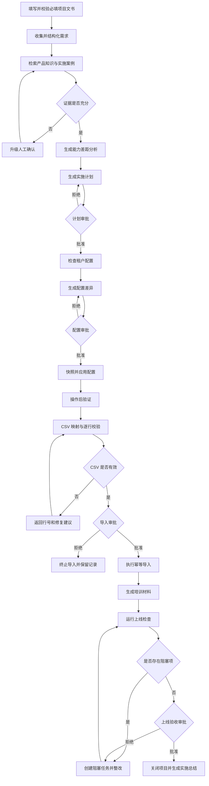
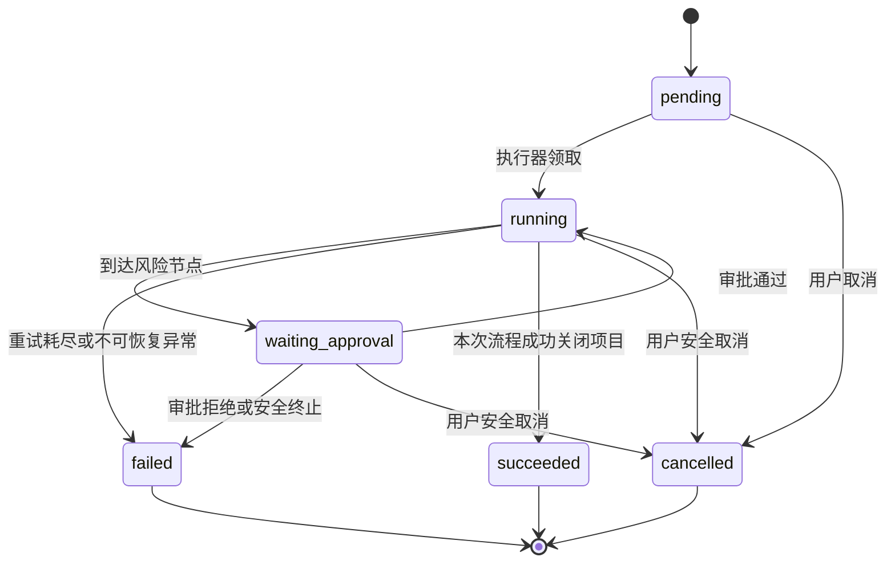

# 系统架构与产品设计

平台包含 Vue 客户端、FastAPI API、PostgreSQL、多阶段实施工作流、Celery Worker/Beat、统一知识索引及可选真实模型服务。SQLite 和确定性模式用于本地功能验证。

## 文档导航

[agent.md](agent.md) · [api.md](api.md) · [architecture.md](architecture.md) · [data_pipeline.md](data_pipeline.md) · [deployment.md](deployment.md) · [evaluation_report.md](evaluation_report.md) · [rag.md](rag.md) · [testing.md](testing.md)

## 本文内容

- [仓库目录与维护边界](#repository-layout)
- [产品需求与业务架构](#product-specification)
- [CRM 后续接入设计](#crm-design)

## 组件与职责

| 组件 | 入口与职责 |
| --- | --- |
| 前端 | `frontend/src/`：账号、公司、项目、对话、审批、交付与平台管理 |
| API | `backend/main.py` 及路由模块：身份、授权、CSRF、参数和幂等校验 |
| 业务执行 | `backend/workflow.py`、`backend/agent_loop.py`、`backend/execution.py`：阶段、动作、审批、恢复与事务 |
| 原件与检索 | `backend/knowledge_index.py`、`backend/knowledge_retrieval.py`：结构解析、版本与权限过滤、召回和证据 |
| 聊天与记忆 | `backend/chat_pipeline.py`、`backend/chat_context.py`、`backend/context_maintenance.py`：对话、上下文、维护与用户记忆 |
| 异步任务 | `backend/worker.py`、`backend/retrieval_queue.py`：业务执行、索引及维护；Beat 单实例调度 |
| 存储与观察 | PostgreSQL/RLS、对象存储、OpenSearch、OpenTelemetry、Prometheus/Tempo |
| 评测 | `scripts/evaluate_project.py`、`scripts/evaluate_cmrc.py`、`config/evaluation.json`：版本绑定、指标和验收聚合 |

业务知识保存在数据库和原件存储中，模型权重使用本地 `data/models` 或部署指定缓存。`knowledge` 目录已删除。


<a id="repository-layout"></a>

## 仓库目录与维护边界

| 目录 | 职责 |
| --- | --- |
| `backend/` | API、业务逻辑、Agent、RAG、权限和持久化 |
| `frontend/` | Vue 界面、前端依赖与构建配置 |
| `docs/` | 按八个主题维护的项目说明、操作文档与历史验收记录 |
| `scripts/` | 部署初始化、备份恢复脚本及监控配置 |
| `alembic/` | 数据库迁移历史，不按代码引用次数删除 |
| `tests/` | 自动化测试与隔离数据库验收工具 |
| `evaluations/` | 检索与工作流题库、原文快照、统计和许可 |
| `data/` | 模型缓存、评测运行记录和其他本地运行数据，不入版本控制 |
| `skills/` | 项目文书模板与技能定义 |
| `backups/` | 本地业务备份，不入版本控制 |

根目录保留 README、环境示例、依赖清单、启动入口、Docker 与迁移配置。
本地 `.env`、SQLite 数据库和备份继续使用原位置，避免破坏既有配置。
`.venv` 与 `frontend/node_modules` 是已安装运行依赖，不作为垃圾删除。
`frontend/dist` 是本地同源页面的运行产物，清理后需重新构建才能访问界面。

### 可清理内容

Python 字节码、pytest/Ruff/mypy 缓存、TypeScript 增量信息、Vite 缓存和
确认属于测试运行的临时文件可删除。运行检查后再次清理，以免遗留新缓存。
不要对 `.git`、业务数据库、迁移历史、备份或依赖目录执行批量垃圾清理。

### 修改目录时的检查

同步更新后端静态目录、启动器、Docker 构建上下文、Compose 挂载及文档路径。
执行 Python 静态检查、pytest、Vue 类型检查与前端构建。
旧引擎、命令行入口、路由注册与动态调用不能仅凭文本引用较少判定为死代码。

<a id="product-specification"></a>

## 产品需求与业务架构

> 原产品规格保留目标、阶段规划及当时的实现状态。它不是当前功能清单；当前路由见 api.md，实际验收见 evaluation_report.md。

| 文档属性 | 内容 |
|---|---|
| 产品名称 | 项目协作 SaaS 客户上线与实施 Agent |
| 文档版本 | V1.0 |
| 产品阶段 | 可运行 MVP / 生产化规划 |
| 目标用户 | 实施顾问、客户联系人、审批人、平台管理员、观察者 |
| 部署形态 | 单机 Docker Compose 演示环境 |
| 更新时间 | 2026-08-21 |

> 本文保留产品需求基线。当前已实现能力、交付边界和生产准备状态分别以项目 [`README.md`](../README.md)、[全流程实施与验收记录](evaluation_report.md#delivery-acceptance)和[生产安全检查](deployment.md#safety-review-20260915)为准；未实施目标不得视为当前功能。

### 1. 产品概述

#### 1.1 产品背景

项目协作 SaaS 的客户上线通常包含需求调研、产品能力匹配、实施计划制定、租户配置、成员数据迁移、培训、上线检查和验收。传统实施高度依赖顾问手工推进，存在以下问题：

- 客户材料格式不统一，需求容易遗漏或理解偏差。
- 产品能力判断缺少可追溯证据，容易出现过度承诺。
- 计划、配置、迁移、培训和验收分散在不同工具中。
- 配置修改和批量导入风险高，缺少统一审批与审计。
- 流程中断后依赖人员记忆恢复，容易重复执行。
- 项目进度、阻塞项和 Agent 行为对客户与管理者不透明。

#### 1.2 产品定位

本产品是一个面向项目协作 SaaS 客户上线场景的业务执行型 Agent 系统。它不是单轮问答机器人，而是能够创建项目、拆解任务、调用受控工具、等待人工审批、保存业务状态并持续推进到验收关闭的实施控制平台。

#### 1.3 产品目标

系统接收客户需求文本、组织成员 CSV、租户配置和知识资料，自动完成：

1. 客户需求收集与结构化。
2. 项目创建前必填校验与需求结构化。
3. 产品能力证据检索与差距分析。
4. 实施计划与里程碑生成。
5. 租户配置检查、差异生成、审批和应用。
6. CSV 字段映射、逐行校验、审批和模拟导入。
7. 培训材料生成。
8. 上线前检查、阻塞项跟踪和客户验收。
9. 中断恢复、幂等执行、审计、评测和可观测性。

#### 1.4 非目标

- 不构建完整的通用项目管理 SaaS。
- 不连接真实企业生产租户、邮件、支付或客户数据库。
- 不允许 Agent 执行任意 SQL、Shell 或未注册工具。
- MVP 不处理复杂 Excel 公式或第三方数据库迁移。
- MVP 不以 Redis 保存不可恢复的核心业务事实。
- MVP 不承诺在未运行真实模型评测前达到生产准确率指标。

### 2. 用户与权限

| 角色 | 核心诉求 | 主要权限 |
|---|---|---|
| 平台管理员 | 治理平台和公司，必要时申请客户支持访问 | 公司治理、平台账号、全局审计、系统状态；不直接拥有客户项目权限 |
| 公司管理员 | 管理本公司组织、项目归属和协作 | 成员、项目创建、项目成员、协作、回收站和公司审计；不自动拥有 Run、导入或审批权限 |
| 项目经理 | 负责指定项目的推进和成员配置 | 项目编辑、成员管理、Run 启动/取消/重试和审批结果查看 |
| 实施顾问 | 执行指定客户项目的实施工作 | 项目编辑、Run 执行、导入校验/提交/执行和交付物生成 |
| 客户联系人 | 完善需求并查看实施进度 | 查看项目、反馈需求、确认计划、提交验收意见 |
| 审批人 | 控制高风险业务操作 | 审批或拒绝计划、配置、导入和上线验收 |
| 观察者 | 查看项目进展和结果 | 只读访问项目、计划、执行记录和报告 |

#### 2.1 权限原则

- 默认最小权限。
- 角色与权限映射来自数据库权限目录；每位成员在同一项目只有一个主角色。
- 例外动作使用有原因、授予人和到期时间的临时能力，且不能授予审批、删除、成员、协作或平台治理权限。
- 平台支持访问必须由目标公司管理员批准，只读、限项目且最长 8 小时。
- 高风险操作必须具备有效审批凭证。
- 发起高风险操作的用户不能审批自己的请求。
- 所有写请求必须带 `Idempotency-Key`。
- 所有关键动作必须写入不可变审计事件。
- 客户文件、密钥和完整 Prompt 不进入普通日志。

### 3. 核心业务对象

| 对象 | 说明 | 关键状态 |
|---|---|---|
| 实施项目 | 一次客户上线实施的业务容器 | draft、ready、in_progress、blocked、completed、cancelled、archived |
| Agent Run | 一次可恢复的流程执行 | pending、running、waiting_approval、succeeded、failed、cancelled |
| 结构化需求 | 从材料中提取的业务要求 | category、statement、priority、source |
| 差距项 | 需求与产品能力的匹配结果 | supported、partial、gap、human_review |
| 实施计划 | 里程碑、任务、依赖、负责人和风险 | draft、pending_approval、approved、rejected |
| 配置变更 | 对租户配置的结构化变更建议 | low、medium、high risk |
| 导入任务 | CSV 校验、审批和执行记录 | validated、invalid、approved、completed、partial_failed |
| 审批请求 | 高风险节点的人工决策 | pending、approved、rejected |
| 验收报告 | 上线检查结果及阻塞项 | ready、blocked、accepted |
| 审计事件 | 不可变的关键操作记录 | event_type、actor、resource、payload、time |

### 4. 端到端业务流程



#### 4.1 主流程节点定义

##### 4.1.1 创建项目 `create_project`

输入：

- 项目名称。
- 客户名称。
- 初始需求文本。
- 发起人身份。
- `Idempotency-Key`。

处理：

- 校验用户是否为平台管理员或实施顾问。
- 创建实施项目和审计事件。
- 相同幂等键重复提交时返回已有项目。

输出：项目 ID、项目状态、`request_id`、`trace_id`。

##### 4.1.2 收集需求 `collect_requirements`

输入：需求文档、客户对话、组织信息和配置目标。

处理：

- 识别组织、权限、工作流、迁移、培训等需求类别。
- 将自然语言转换为 `RequirementSpec`。
- 保存需求来源和优先级。

输出：结构化需求列表。

##### 4.1.3 项目文书完整性校验

项目名称、客户、联系人、邮箱、员工规模、目标上线日期、部门清单和具体实施需求在创建项目时由前后端共同校验；未通过时返回字段级错误，不创建项目，也不启动 Run。

Agent 不再根据关键词命中情况把 Run 暂停为“等待补充资料”。需求未命中预设类别时保留客户原始描述为 `general` 通用需求，继续知识检索、差距分析和实施计划审批。业务不确定性由计划审批处理，而不是进入无法恢复的资料等待状态。

##### 4.1.4 知识检索 `retrieve_product_knowledge`

检索范围：产品功能、管理员配置、实施 SOP、历史案例、导入错误说明和培训模板。

目标流程：

```text
问题规范化 → 元数据过滤 → 向量召回 → 关键词召回
→ 合并去重 → 重排 → 返回引用证据
```

每条证据至少包含文档 ID、标题、模块、版本、文本片段和相关性评分。

##### 4.1.5 差距分析 `gap_analysis`

每项需求必须输出：

- 对应产品能力。
- 匹配状态：完全支持、部分支持、能力缺口或人工确认。
- 引用证据 ID。
- 实施建议。

规则：无有效证据时不得输出确定性的“支持”结论，必须标记为 `human_review`。

##### 4.1.6 生成实施计划 `generate_implementation_plan`

默认生成三个阶段：

1. 调研与方案。
2. 配置与迁移。
3. 培训与上线。

每个里程碑包含名称、预计天数、负责人角色、依赖关系、假设和风险。

##### 4.1.7 计划审批 `plan_approval`

- 创建 `plan` 类型审批请求。
- Run 状态切换为 `waiting_approval`。
- 批准后进入租户检查。
- 拒绝后携带审批意见返回计划生成节点。
- 审批过程写入审计日志。

##### 4.1.8 租户配置检查 `inspect_tenant_configuration`

检查范围：

- 工作空间基础信息。
- 部门与成员。
- 角色及权限。
- 项目模板。
- 任务状态流。
- 自定义字段。
- 通知规则。

Agent 只能通过 `inspect_tenant_config` 工具读取模拟 SaaS，不能直接查询或修改底层数据库。

##### 4.1.9 配置差异生成 `generate_configuration_changes`

每项变更包含配置路径、旧值、新值、风险等级和变更原因。权限、状态流等敏感配置默认判定为高风险。

##### 4.1.10 配置审批与应用

执行顺序固定为：

```text
参数校验 → 权限检查 → 幂等检查 → 审批凭证检查
→ 操作前快照 → 应用配置 → 操作后验证 → 审计记录
```

任何环节失败都不得伪造成功结果。超时最多指数退避重试三次。

##### 4.1.11 CSV 校验 `validate_import_files`

MVP 支持成员 CSV，标准字段如下：

| 标准字段 | 支持别名 | 必填 | 校验规则 |
|---|---|---:|---|
| name | 姓名、成员姓名 | 是 | 非空 |
| email | 邮箱、邮件 | 是 | 合法格式、文件内唯一 |
| department | 部门、dept | 是 | 非空 |
| role | 角色 | 是 | 非空 |

错误响应必须包含：行号、字段、错误原因和修复建议。校验失败时禁止进入执行导入。

##### 4.1.12 导入审批与执行

- 有效 CSV 才能创建导入审批。
- 执行导入需要有效的 `import` 类型批准记录。
- 相同幂等键不得重复导入。
- 部分失败时记录成功项和失败项，后续重试不得重复导入成功数据。
- 完成后校验成功数、失败数和目标租户数据。

##### 4.1.13 培训材料生成 `generate_training_materials`

输出至少包括：

- 管理员快速入门。
- 普通成员操作指南。
- 常见问题 FAQ。

后续版本应根据角色、已启用模块和客户配置生成差异化内容。

##### 4.1.14 上线检查 `run_go_live_checks`

检查项包括：

- 实施计划已审批。
- 管理员与成员数据完整。
- 角色权限符合方案。
- 租户配置已应用且验证通过。
- 导入任务无未处理失败。
- 培训材料已交付。
- 无未关闭的高风险阻塞项。

任一关键项失败时，验收报告标记为 `ready=false`，并自动创建阻塞任务。

##### 4.1.15 验收与关闭

- 审批人或客户授权验收人提交最终决定。
- 批准后项目状态变为 `completed`。
- 系统生成实施总结、验收报告和完整审计链路。
- 拒绝后创建整改任务，修复后重新运行上线检查。

### 5. 状态机与恢复机制

#### 5.1 Run 状态



失败或取消的 Run 不在原记录上恢复为 running；修订后创建新 Run，并通过 `retry_of_run_id` 关联历史执行。

#### 5.2 Checkpoint 内容

`ImplementationGraphState` 只保存 JSON 可序列化内容：

- project_id、run_id。
- current_node、status。
- 结构化需求。
- 差距项和引用 ID。
- 实施计划。
- 配置变更。
- import_job_id。
- pending_approval_id。
- 验收报告。
- completed_nodes。

大文档、文件内容、数据库连接和密钥不得写入 Graph State。

#### 5.3 恢复规则

- 每个节点成功后持久化 Run State 和 Agent Step。
- 服务或 Worker 重启后，从最后成功节点的后继节点继续。
- 已完成节点不重复执行。
- 等待审批时重启，审批 ID 和业务状态不得丢失。
- 工具执行依靠幂等键防止 Checkpoint 边界造成重复副作用。

### 6. 异常流程

| 异常 | 系统行为 | 恢复方式 |
|---|---|---|
| 项目必填信息不完整 | 拒绝创建项目并返回字段错误 | 修正表单后重新提交 |
| 检索证据不足 | 禁止确定性结论，转人工确认 | 增补证据或人工决策 |
| 计划被拒绝 | 保存审批意见 | 返回计划生成节点 |
| 配置被拒绝 | 不执行任何配置写入 | 修改方案后重新审批 |
| CSV 字段错误 | 返回行号和修复建议 | 修复文件后重新校验 |
| 重复邮箱 | 标记对应行，不执行导入 | 合并或修改重复记录 |
| 工具超时 | 指数退避，最多三次 | 失败后创建阻塞项 |
| 重复请求 | 返回已有结果 | 无需重新执行 |
| 审批凭证无效 | 拒绝高风险工具调用 | 获取有效审批凭证 |
| 审批人自批 | 返回 403 | 更换独立审批人 |
| Worker 重启 | 从数据库状态恢复 | 自动继续 |
| 部分导入失败 | 保留逐行成功/失败结果 | 仅重试失败数据 |
| 上线检查失败 | 生成阻塞任务 | 整改后重新检查 |

### 7. 前端信息架构

#### 7.1 页面清单

| 页面 | 核心内容 | MVP 状态 |
|---|---|---|
| 登录页 | 平台/客户独立身份认证 | 已实现 Cookie 会话、CSRF 和账号边界 |
| 项目列表 | 客户、状态、当前阶段、负责人 | 已实现核心视图 |
| 新建项目 | 客户信息和初始需求 | 已实现 |
| 需求与材料 | 结构化需求、来源、缺失项 | 状态数据已具备，待独立页面 |
| 能力差距 | 支持状态、建议、引用证据 | 状态数据已具备，待独立页面 |
| 实施计划 | 里程碑、依赖、风险 | API 已实现，待甘特视图 |
| Agent 执行详情 | 当前节点、状态、Trace 和结构化 State | 已实现 |
| 审批中心 | 待审批列表、批准、拒绝、意见 | 已实现核心交互 |
| 配置差异 | 旧值、新值、风险、原因 | 数据已实现，待独立页面 |
| CSV 校验 | 字段映射、错误预览、修复建议 | API 已实现，待独立页面 |
| 知识库管理 | 文档上传、版本和元数据 | 规划中 |
| 上线验收 | 检查结果、阻塞项和报告 | API 已实现，待独立页面 |
| Trace 与评测 | Token、耗时、Trace、质量得分 | 基础 Trace/评测已实现 |

#### 7.2 Agent 实时执行页要求

必须展示：

- 当前 Graph 节点。
- Agent 或专家角色。
- 工具调用名称、状态和耗时。
- 检索证据引用。
- 重试、超时和错误。
- 等待输入或等待审批状态。
- Token、模型成本和总耗时（接入真实模型后）。
- `request_id`、`trace_id`、`run_id`。

实时状态通过 `GET /api/runs/{id}/events` 的 SSE 推送。

### 8. API 需求

#### 8.1 已实现核心接口

| 方法 | 路径 | 作用 |
|---|---|---|
| POST | `/api/auth/token` | 获取演示 JWT |
| POST | `/api/projects` | 创建实施项目 |
| GET | `/api/projects` | 查询项目列表 |
| GET | `/api/projects/{id}` | 查询项目详情 |
| POST | `/api/projects/{id}/runs` | 启动实施流程 |
| GET | `/api/runs/{id}` | 查询 Run 和 Graph State |
| GET | `/api/runs/{id}/events` | SSE 执行事件 |
| GET | `/api/approvals` | 查询审批列表 |
| POST | `/api/approvals/{id}/decision` | 批准或拒绝并恢复流程 |
| POST | `/api/imports/validate` | 校验成员 CSV |
| POST | `/api/imports/{id}/execute` | 携审批凭证执行导入 |
| GET | `/api/projects/{id}/plan` | 查询实施计划 |
| GET | `/api/projects/{id}/go-live-report` | 查询验收报告 |
| POST | `/api/platform/evaluations/run` | 平台人员运行固定评测 |
| GET | `/api/platform/evaluations/{id}` | 平台人员查询评测结果 |
| GET | `/health` | API 健康检查 |
| GET | `/metrics` | Prometheus 指标 |

#### 8.2 统一协议

业务响应结构：

```json
{
  "data": {},
  "request_id": "request correlation id",
  "trace_id": "distributed trace id"
}
```

写请求规则：

- 必须包含 `Idempotency-Key`。
- JSON 参数必须通过 Pydantic 校验。
- 401 表示未认证，403 表示权限或审批不足，404 表示资源不存在，409 表示业务状态冲突，422 表示参数错误。

#### 8.3 后续接口

- `POST /api/projects/{id}/documents`
- `POST /api/projects/{id}/requirements/complete`
- `GET /api/runs/{id}/steps`
- `GET /api/runs/{id}/tool-executions`
- `POST /api/platform/knowledge/documents`
- `GET /api/platform/knowledge/documents`
- `GET /api/projects/{id}/blockers`
- `POST /api/blockers/{id}/resolve`

### 9. 数据需求

#### 9.1 核心业务表

- `users`、`roles`
- `customer_tenants`
- `implementation_projects`
- `requirements`
- `gap_items`
- `milestones`
- `implementation_tasks`
- `configuration_snapshots`
- `import_jobs`、`import_rows`
- `knowledge_documents`、`knowledge_chunks`
- `agent_runs`、`agent_steps`
- `tool_executions`
- `approval_requests`
- `idempotency_records`
- `audit_events`
- `evaluation_runs`

#### 9.2 数据保留原则

- PostgreSQL 是唯一业务事实来源。
- Redis 仅保存队列、缓存、锁、限流和临时事件。
- 审计事件不可原地修改。
- Checkpoint 与业务表使用独立 schema 或表空间。
- 删除客户数据需按租户隔离并生成审计记录。

### 10. Agent 与工具设计

#### 10.1 专家角色

| Agent | 职责 |
|---|---|
| Requirement Agent | 提取并结构化已校验的项目需求 |
| Product Consultant Agent | 将需求映射到产品能力和证据 |
| Implementation Planner Agent | 生成里程碑、任务、依赖和风险 |
| Configuration Agent | 检查租户并生成配置差异 |
| Data Migration Agent | 字段映射、错误解释和导入计划 |
| Training Agent | 生成角色化培训内容 |
| Acceptance Agent | 执行上线检查并生成验收报告 |
| Supervisor Agent | 检查证据、风险和输出完整性，决定是否升级人工 |

MVP 使用确定性节点保证无模型密钥也能运行；生产版采用 Supervisor 将专家 Agent 作为工具调用的模式。

#### 10.2 受控工具

- `search_product_docs`
- `search_implementation_cases`
- `inspect_tenant_config`
- `compare_requirement_to_capability`
- `create_milestone`
- `create_implementation_task`
- `validate_csv_schema`
- `generate_field_mapping`
- `preview_import`
- `execute_import`
- `apply_tenant_config`
- `generate_training_outline`
- `run_go_live_checklist`
- `create_blocker`
- `request_human_approval`

工具必须具有明确的 Pydantic 参数，不允许通过工具执行任意代码。

### 11. 可观测性

#### 11.1 Trace 链路

```text
HTTP Request → FastAPI → Worker Publish → Celery Worker
→ Workflow Node → Expert Agent → RAG/Tool → PostgreSQL/Redis
```

每次执行关联：

- trace_id
- request_id
- project_id
- agent_run_id
- graph_thread_id
- tool_execution_id

#### 11.2 指标

- API 请求量、错误率和 P95 延迟。
- Run 数量、成功率和平均完成时间。
- 节点重试次数和失败节点分布。
- 工具失败率和执行耗时。
- 待审批数量和平均等待时长。
- RAG 检索耗时与 Recall@5。
- 模型 Token、延迟和成本。
- Celery 队列长度。
- PostgreSQL 连接池状态。

MVP 已提供 `/metrics` 和 `saas_agent_up` 指标，Prometheus Target 状态为 `up`。

### 12. 评测需求

固定评测集不得少于 50 条，覆盖：

- 需求抽取。
- 项目文书校验与通用需求回退。
- 能力差距判断。
- RAG 引用。
- 工具选择。
- 配置风险判断。
- CSV 字段映射。
- 上线检查。
- 越权操作拒绝。
- 多轮流程恢复。

#### 12.1 目标指标

| 指标 | 目标 |
|---|---:|
| Pydantic 结构化输出解析成功率 | 100% |
| RAG Recall@5 | ≥85% |
| 引用证据正确率 | ≥90% |
| 工具选择准确率 | ≥90% |
| 高风险操作审批拦截率 | 100% |
| 幂等测试通过率 | 100% |
| 固定评测集任务完成率 | ≥80% |
| 非 LLM API 本地 P95 | <500ms |

当前确定性评测集共 55 条；本地 RAG 子集 Recall@5 为 1.0。该结果只代表内置演示语料，不等同于生产知识库结果。

### 13. 非功能需求

#### 13.1 性能

- 非 LLM API 本地 P95 小于 500ms。
- SSE 事件延迟小于 2 秒。
- 2 MB 以下 CSV 在 5 秒内完成校验。
- Agent 长任务不得阻塞 API 事件循环，生产版交给 Worker。

#### 13.2 可靠性

- 关键节点完成后立即保存状态。
- 高风险工具具备幂等保护。
- 外部工具超时最多重试三次。
- 单个 Worker 故障不得导致业务状态丢失。

#### 13.3 安全

- JWT 或企业身份认证。
- 租户数据隔离。
- 服务密钥从环境变量或密钥服务读取。
- 日志脱敏。
- 文件大小、类型和恶意内容校验。
- 配置应用与导入强制审批。

#### 13.4 部署

- Docker Compose 一键启动。
- API、Web、PostgreSQL、Redis、Prometheus 和 Grafana 独立容器。
- API 和 PostgreSQL 提供健康检查。
- 当前宿主机 PostgreSQL 映射端口为 `5433`，避免与本机已有 `5432` 冲突。

### 14. MVP 验收场景

使用虚构客户“星河设计公司”：

1. 顾问创建“星河设计上线项目”。
2. 输入 80 名成员、部门、角色权限、项目模板、审核状态流、CSV 导入和培训要求。
3. Agent 提取结构化需求并检索产品证据。
4. Agent 生成三阶段实施计划，在 `plan_approval` 暂停。
5. 审批人批准计划，流程恢复至配置检查。
6. Agent 生成包含高风险工作流变更的配置差异，在 `configuration_approval` 暂停。
7. 批准后系统记录操作前快照、应用配置并验证。
8. 上传包含部门缺失和重复邮箱的 CSV，系统返回准确行号和修复建议，禁止导入。
9. 修复 CSV 后重新校验并发起导入审批。
10. 批准后执行幂等导入并输出成功/失败数量。
11. 系统生成管理员指南、成员指南和 FAQ。
12. 执行上线检查并生成验收报告。
13. 最终审批通过后项目变为 `completed`。
14. 展示 SSE 执行详情、审计事件、Trace、Prometheus 和固定评测结果。

#### 14.1 MVP 验收标准

- 能通过 Docker Compose 启动六个服务。
- API `/health` 返回 200，Prometheus Target 为 `up`，Web 返回 200。
- Run 能在四个高风险审批点暂停。
- 审批后能从持久化状态继续执行。
- 未审批的高风险操作无法执行。
- 相同幂等键不会产生重复业务结果。
- CSV 错误包含行号、字段和修复建议。
- 所有 Agent State 可通过 Pydantic 校验。
- 后端自动测试、静态检查和前端构建通过。
- README 和本 PRD 能指导启动、演示、恢复和二次开发。

### 15. 版本规划

#### V1.0：可演示业务闭环

- 项目创建、确定性状态机、数据库恢复。
- 需求、RAG、差距、计划、审批、配置、CSV、培训和验收主链路。
- Vue 控制台、SSE、Docker Compose、基础指标和 55 条评测集。

#### V1.1：生产级工作流与数据

- LangGraph StateGraph 与 PostgreSQL Checkpointer。
- Celery Worker、Redis 锁、限流、超时和指数退避。
- Alembic 迁移和完整业务数据表。
- 模拟 SaaS 的成员、模板、状态流和自定义字段 CRUD。
- CSV 部分成功及失败行重试。

#### V1.2：智能 Agent 与知识库

- OpenAI Agents SDK 专家 Agent 与 Supervisor。
- 65 篇以上授权知识资料。
- pgvector、全文检索、混合召回和 reranker。
- Prompt 版本、Guardrail、结构化重试和 Mock Model 回归。

#### V1.3：观测、评测与产品化

- OpenTelemetry Collector 和跨 API/Worker Trace。
- Langfuse Cloud Trace、Prompt、Dataset 和 Experiment。
- Grafana 业务仪表盘和告警。
- 13 个完整前端页面、甘特图、知识库管理和 Trace 详情。
- 完整性能、故障注入和端到端测试报告。

### 16. 风险与待决策事项

| 风险/决策 | 影响 | 建议 |
|---|---|---|
| 真实模型输出存在波动 | 影响需求和工具选择一致性 | Pydantic 校验、结构化重试、Mock 回归、人工升级 |
| 客户需求描述质量不稳定 | 影响计划和迁移准确性 | 创建前字段校验、通用需求保真、证据门槛和计划审批 |
| RAG 文档版本冲突 | 可能引用过期产品能力 | 强制版本、生效时间和模块元数据过滤 |
| 高风险工具副作用 | 可能修改租户或重复导入 | 审批、幂等、快照、验证和审计 |
| 长流程跨服务恢复复杂 | 可能重复或漏执行节点 | PostgreSQL Checkpoint 与工具级幂等 |
| 当前演示认证较宽松 | 不适合生产部署 | V1.1 改为默认拒绝并接企业身份源 |
| 是否允许客户自行验收 | 影响权限和责任边界 | 按客户项目指定独立验收人 |
| 数据保留周期尚未确定 | 影响合规和存储成本 | 上线前制定租户级保留与删除策略 |

### 17. 成功定义

产品成功不是 Agent 生成了一段看似合理的回答，而是：

- 一个真实实施项目可以被创建和持续推进。
- 所有关键结论都有结构化结果和可追溯证据。
- 高风险操作始终由人类控制。
- 流程中断后能够安全恢复且不会重复产生副作用。
- 客户、顾问和审批人可以看到当前进度、阻塞原因和下一步动作。
- 最终能够输出可验证的上线结果、验收报告、实施总结和完整审计链路。

<a id="crm-design"></a>

## CRM 后续接入设计

> 设计参考：CRM 远程接入和客户迁移尚未作为本轮任务实施。不要将方案描述或计划中的验收门槛解释为已接入真实 CRM。

> 当前实施范围已按用户后续要求缩减为真实服务验证、生产可靠性验证、不可变执行材料与跨 Worker 追踪。本文中的 CRM 接入方案仅保留为后续设计，本轮不实施。当前实现与验收证据见 [执行安全验收记录](evaluation_report.md#execution-safety)。

编制日期：2026-10-02（北京时间）  
计划性质：实施设计，尚未执行开发、外部写入或上线验收。  
目标：基于现有平台，完成一家客户从 CRM 需求确认、部门与权限配置、员工开通、客户数据迁移、培训到上线签署的可恢复、可审计闭环。

### 1. 现状、边界与最终成果

已有 Vue/FastAPI、身份与公司权限、项目协作、材料审批、工作流、Outbox/Celery、成员导入、交付物、聊天/RAG、数据库迁移和部署脚本，应继续扩展现有架构。

依据 `docs/evaluation_report.md#local-acceptance-20260928` 的 2026-09-28 记录，本机 Docker、真实检索模型、46/46 文档索引、部分备份恢复和 pipeline 5 技术验收已有通过证据，记录了后端 354 通过、4 跳过。它们属于历史、本机和特定数据集结果，本计划没有重新验证当前运行环境。正式检索质量、生成回答质量、独立生产灾备及真实 CRM 业务闭环仍需单独验收。

现有 `backend/delivery.py` 操作的是本地 `SaaSWorkspace/SaaSMember`。`backend/imports.py` 校验姓名、邮箱、部门和角色；这属于员工成员导入，不能代表 CRM 客户或联系人数据迁移。`backend/models.py` 的审批材料与执行回执可以复用，但不足以独立处理远程成功、本地提交失败的情形。

首版完成范围为**一种指定 CRM、一个独立沙箱、一个试点客户**：

| 客户要完成的工作 | 平台最终应提供的能力 | 验收证据 |
| --- | --- | --- |
| 设置部门 | 展示现状、映射目标部门、预览新增/变更、审批后执行 | CRM 中部门及层级回读，与批准方案一致 |
| 设置权限 | 区分平台项目角色与 CRM 业务角色，映射操作权限和数据范围 | 角色矩阵，以及不同测试账号实际访问结果 |
| 开通员工 | 创建或邀请账号，绑定部门/业务角色，检查许可证与激活状态 | CRM 远程 ID、邀请/激活状态、错误明细 |
| 导入客户资料 | 独立客户与联系人模型、字段映射、清洗、去重、负责人和关联关系映射 | 逐行结果、远程 ID、关键字段及关联关系核验 |
| 培训员工 | 基于实际配置生成并审核材料，记录签到、练习和问题整改 | 材料版本、参训清单、练习结果、整改关闭记录 |
| 上线交付 | 汇总远程核验、迁移、权限测试、培训和遗留问题 | 独立客户审批人的验收签署与交付包 |

首版不扩展多 CRM 同时适配、持续双向同步、复杂销售自动化和完整 LMS；真实 CRM 不支持的 API 能力必须显式显示。若厂商无法提供首版要求的部门或权限接口，应调整首个 CRM 选型，或将该项定义为需人工执行并上传证据的任务，不能将人工任务计为自动接入达标。

### 2. 启动条件与业务样例

第一周确认以下信息，缺失项登记责任人与取得时间；未获得沙箱授权时可推进通用基础设施和契约开发，但不能签署真实接入验收。

- CRM 厂商、产品版本、购买套餐、地区、组织 ID、沙箱与 API 文档版本；核对部门、用户、角色、客户及联系人的 API 可用性、限额、许可费用和服务账号能力。
- 客户授权范围与独立审批人；可读取、创建和修改的资源，以及禁止删除或覆盖的对象。
- 企业业务流程、部门树、角色权限矩阵、客户唯一标识、客户与联系人关系、负责人映射、数据重复处理规则。
- 代表性脱敏数据、正式迁移文件的取得方式、敏感字段保留期限、知识资料使用范围与培训名单。
- 生成模型配置和固定版本信息、当前检索模型与索引身份、邮件/对象存储凭据引用；秘密只保存在受控存储中。
- 预生产运行环境、目标容量、告警接收人、维护窗口、备份恢复目标和试点客户验收负责人。

建议样例为 3 个部门、80 名员工、10,000 条客户及其联系人数据；容量预演暂按 50 个项目、20 个活跃执行估算。以上是规划负载，第一周按真实客户数据和厂商配额调整，不作为已有容量承诺。

### 3. 目标流程与架构约束

业务流程：创建实施项目 → 连接 CRM 沙箱 → 读取现状 → 保存需求与基线快照 → 生成配置/迁移/培训计划 → 独立审批 → 分批执行 → CRM 回读核验 → 培训与整改 → 客户验收 → 导出交付包。

保留 Vue/FastAPI、PostgreSQL、Redis、Celery、现有 RAG 与存储架构。新增受控连接器层和远程操作台账：

| 层 | 主要职责 |
| --- | --- |
| 项目页面与审批 | 展示目标组织、差异、数量、影响范围、不可逆项、培训与验收证据 |
| 业务服务与工作流 | 验证当前权限、固定输入、生成操作计划、绑定审批、调度和阻塞整改 |
| 远程操作台账 | 保存稳定操作 ID、请求摘要、重试/未知结果、远程 ID、回读和人工对账 |
| CRM 连接器 | 固定能力接口、授权、分页、限流、数据转换、远程调用与查询核验 |
| 基础设施 | 数据库隔离、对象存储、索引、邮件、Trace、告警、备份与恢复 |

AI 可以提取需求、建议映射和生成材料；对 CRM 的所有写入必须经过业务服务、当前权限检查、批准材料校验与连接器能力白名单。聊天中的一句话不能代替配置或导入审批。连接器不向模型开放任意 URL、任意请求体或任意凭据。

### 4. 阶段、依赖与交付门槛

按 2 名后端、1 名前端、1 名测试及共享运维/业务负责人规划约 12 周；这是基于一个 CRM 的初步估算，第一周调研后重新排期。若由一名开发者完成，需按任务量重新估算，不能直接沿用 12 周。真实服务、资料和沙箱准备可与开发并行，各阶段以验收门槛放行。

| 阶段 | 时间 | 工作包 | 交付物与完成门槛 | 责任角色 |
| --- | --- | --- | --- | --- |
| P0 基线与选型 | 第 1 周 | 复核现有成果；核对 CRM 能力；锁定业务规则、容量和验收集；修正文档矛盾 | 能力矩阵、缺口清单、接口契约、样例数据、环境基线；首版要求均有 API 或明确人工路径 | 业务负责人、技术负责人、测试 |
| P1 权限与执行快照 | 第 2–3 周 | 运行账号检查、RLS、不可变输入、审批绑定、凭据授权、只读连接器 | 跨租户拒绝、权限撤销和材料变更测试通过；沙箱连接能确认正确组织 | 后端、测试、运维 |
| P2 远程执行与配置 | 第 4–5 周 | 操作台账、调度与对账、限流、配置差异预览、部门/角色/账号操作 | 沙箱创建与回读闭环；超时和重复消息不造成未解释重复写入；审批失效阻止执行 | 后端、前端、测试 |
| P3 客户数据迁移 | 第 6–7 周 | 客户/联系人模型、字段映射、去重、负责人和关系映射、分批导入、失败行恢复 | 样例迁移逐行结果可追溯；总量、关键字段、关系核验通过；成功行不被重复写入 | 后端、前端、业务负责人、测试 |
| P4 真实服务与培训 | 第 8–9 周 | 正式质量评测、真实邮件/S3 联调、培训证据、跨 Worker Trace 和告警 | 质量报告、真实服务回执、培训记录；故障能定位和通知；当前高延迟有实测改进结果 | AI/后端、前端、运维、业务负责人 |
| P5 独立预生产验收 | 第 10–11 周 | PG 迁移、实际运行角色、Worker kill、外部效果故障、容量、备份恢复与索引重建 | 故障和恢复报告、已验证恢复点、数据及权限一致性证据；所有阻断项关闭 | 测试、运维、后端 |
| P6 试点与上线签署 | 第 12 周 | 小批量试运行、全量迁移、培训、客户验收、发布和退出方案 | 一个真实 CRM 客户项目完成签署；上线条件满足；后续支持负责人明确 | 客户审批人、实施负责人、运维 |

依赖：P1 是任何远程写入的前置条件；P2 是 P3 的前置条件；质量集与真实服务准备在 P0 开始，P4 完成判定；P5 通过后才进入正式试点写入。未满足门槛时允许继续无依赖工作，不把缺失证据标成完成。

### 5. P1：权限、快照与授权

#### 5.1 不可变执行材料

新增 `RunSnapshot`，将需求正文、需求文档版本及内容哈希、方案、导入文件哈希与行清单、字段映射、批准规则版本、连接目标组织、连接器/API 版本、提示词和检索身份固化。阶段材料新增不可变修订并记录父修订，避免把 Run 当前 JSON 状态当成完整快照。

动态检索和模型调用逐次保存来源文档/片段版本、输入输出的受控记录、请求摘要及供应商返回模型信息。支持固定模型版本时锁定版本；只提供可变别名的供应商必须标为“无法保证精确重放”，可以保证输入和审批可追溯，不能声称输出完全可复现。

通过数据库更新限制或触发器保护批准修订；原文件存入受控对象存储并校验哈希，按客户保留期限处理。快照只保存凭据引用，不保存令牌。历史 Run 标为未具备完整快照，不能补造当时输入。

审批绑定 `run_id + revision_id + connection_id + remote_org_id + operation_manifest_hash`。目标组织、文件、映射、写入范围、批准规则或执行材料改变后，旧审批不适用于新修订。再次执行仍检查当前用户/服务权限，不能用旧快照延续已撤销授权。

完成条件：编辑项目原需求不影响正在执行的已批准材料；改变输入必须重新审批；撤权/停用连接后排队写入被拒绝；审批人不能批准自己的写入请求。

#### 5.2 数据与运行账号隔离

审计全部业务、连接器、快照、操作、索引和文件元数据表，补齐适用的 RLS 与写入校验；以实际 API/业务 Worker/索引 Worker 账号测试。应用角色不得成为租户业务表所有者、超级用户或能切换到绕过 RLS 的角色。启动和部署检查有效角色、角色继承、表所有权、授权范围以及 owner 凭据泄漏。

Outbox 发布和全租户索引属于后台服务能力，应使用专用、范围明确的服务权限；不能给所有 Worker 隐式全租户业务写权限。每次执行恢复租户/项目上下文，跨事务、连接池复用、commit/rollback、无上下文都需要测试。

RAG 测试同时核对候选集、送入重排的正文、模型上下文和最终输出，覆盖知识库、附件、历史及 Memory。未授权高相关资料必须在进入重排和模型前被排除，当前权限变化后必须重新授权。

数据库规则依据 [PostgreSQL 16 行级安全文档](https://www.postgresql.org/docs/16/ddl-rowsecurity.html)：表所有者通常绕过 RLS，超级用户和 BYPASSRLS 角色始终绕过；FORCE RLS 不能替代实际角色核验。

#### 5.3 CRM 连接与凭据

每个连接绑定租户、项目授权范围、厂商、环境和远程组织；多个项目共享同一 CRM 组织时，按连接/资源协调写入，现有单项目单活跃 Run 约束不能代替跨项目协调。

使用厂商支持的 OAuth 或受控服务账号；采用 OAuth 授权码流程时验证 state、重定向地址和 PKCE，刷新/撤销策略按供应商能力实现。凭据存入受控密钥存储，支持轮换，前端只显示连接状态与授权范围。请求目标来自厂商白名单，阻止重定向或配置输入将调用送入内部网络；令牌、客户正文不进入通用日志和 Trace。

OAuth 设计参考 [RFC 9700](https://www.rfc-editor.org/rfc/rfc9700.html)，具体授权和账号开通能力以 P0 锁定的 CRM 官方文档为准。

### 6. P2：连接器与远程操作可靠性

#### 6.1 连接器契约

建议新增 `backend/connectors/`，保留内置 SaaS 为演示适配器，首个真实厂商实现固定接口：连接与能力检查、读取现状、计算配置差异、应用已批准变更、账号开通/邀请、客户/联系人批次提交、查询批次结果、资源回读和受支持补偿。

每个能力声明支持状态、许可前置条件、可否幂等、可否回读、可否补偿、最终一致性等待时间、分页与配额。不要假设所有 CRM 都支持创建部门、配置角色、账号即时激活或撤销导入。开发期间用契约测试验证参数、返回值和错误分类；真实沙箱测试验证实际效果。

页面新增：连接管理、现状与配置差异、员工账号预览、操作状态与未知结果、人工对账。平台权限和 CRM 权限分开展示，例如“能在本平台审批”并不意味着“在 CRM 有管理员权限”。

#### 6.2 远程操作台账

新增 `ExternalOperation`、`ExternalOperationAttempt`、`RemoteResourceMapping`；稳定操作 ID 不依赖消息投递次数和重试次数，按租户、连接、组织、业务资源及批准版本约束唯一性。同一幂等键配不同请求哈希必须拒绝。

操作状态建议为 planned、approved、queued、executing、verifying、succeeded、failed、unknown、cancelled、compensation_required、compensated。记录操作者、批准材料哈希、尝试次数、远程请求 ID、远程资源 ID、回读结果和人工处理人，成功由核验支持。

执行过程：

1. 本地短事务写入操作台账和 Outbox，提交后才调用远程。
2. Worker 领取带租约/版本的任务，重新校验当前权限、批准版本、连接组织和取消状态；不在网络调用期间保持长数据库锁。
3. 厂商支持幂等键时传入稳定操作 ID；支持唯一外部键/upsert 时绑定已批准的业务唯一键。
4. 收到结果后保存回执并查询核验；异步批量任务轮询远程任务 ID，HTTP 202 不代表导入完成。
5. 超时、进程终止或本地提交失败造成结果不明时进入 unknown，优先凭幂等键、远程 ID 或唯一业务键查询。远端缺少可靠识别手段时转人工对账，禁止盲目重试。

租约只能控制本地领取，不能保证厂商阻止已经在途的请求。使用厂商版本条件或幂等能力约束竞争；旧 Worker 状态不明时暂停相同资源写入并对账。取消仅阻止后续工作，已经发送的请求可能仍成功，必须继续核验。

错误分类：配额/临时故障按有上限的指数退避与 Retry-After 调度；401 仅受控刷新一次后停止；权限不足、许可不足、字段错误和版本冲突转整改；含糊的 5xx/断线写入先对账再决定重试。批次大小与并发由厂商配额和实测结果决定。

补偿只针对已确认由本次操作创建/修改且远程版本未发生后续变化的资源，并再次审批。首版默认不自动删除已有客户或覆盖既有角色；无法安全补偿时提供人工处理报告。不能用本地数据库回滚证明 CRM 已回滚，也不承诺跨系统 exactly-once。

完成条件：远程成功后杀 Worker、远程成功后本地事务失败、重复投递、租约到期、执行中取消、两项目竞争同一组织等场景均有可解释结果；无未经批准的追加权限和重复客户记录。

### 7. P3：客户与联系人迁移

新增独立 `CustomerImportJob`、`CustomerImportRow` 或带明确 entity_type 的迁移模型，保留现有成员导入兼容入口。首版至少覆盖客户、联系人及其归属员工/部门关系；销售机会等对象后续按客户需求扩展。

完整流程：上传 → 文件校验与受控保存 → 字段映射 → 清洗/验证 → 查询 CRM 现状 → 差异及冲突预览 → 冻结行清单并审批 → 小批量试导 → 逐批导入 → 回读核验 → 错误行整改 → 独立验收。

- 文件限制、编码、表头、日期、枚举、必填字段、电话与自定义字段类型检查；按预计规模分块读取，不把全部数据写进日志、模型上下文或单个状态 JSON。
- 以客户确认的稳定业务唯一键建立源记录到远程 ID 的映射；客户不能仅凭邮箱或名称去重。定义重复跳过、冲突人工处理、明确授权的更新规则。
- 先完成员工/部门映射，再导入客户，再导入联系人及关系；缺少负责人、重复业务键、无对应客户的联系人阻塞对应行。
- 显示新增、更新、跳过、冲突和错误数；批准的是具体数据、映射和操作模式。试导清单属于批准范围，修改后重新校验审批。
- 每行记录源行号、稳定源 ID、操作 ID、远程 ID、验证结果和失败原因；失败行重试关联原任务，已成功行不重做，unknown 行先对账。
- 验证完整行清单与远程业务键/ID、负责人和关系；关键字段可通过官方批量查询或导出核验。数据量或 API 限制导致只能抽查时明确覆盖率和限制，不能宣布全量字段一致。

建议沙箱试导 100 条，再导入剩余批准记录。验收以“输入清单每行均有最终去向、有效批准行满足业务核验”为准；被业务审批人明确排除的无效行另列，不能通过改分母隐藏失败。

### 8. P4：真实 AI、检索、服务、培训与观测

#### 8.1 质量评测与性能

复用已通过的真实检索部署，优先建立业务验证集和生成回答评测，不重复建设已完成的本机技术链路。以选定 CRM 的授权手册、实施规范、权限矩阵和脱敏项目资料构建至少 200 道独立复核题，包含无答案、跨来源冲突、旧版本、表格、扫描件、权限边界与实际业务表达；题目按文档/客户域拆分开发集和锁定验收集。

锁定版本、标签、必要事实和引用位置；锁定集结果只用于验收，失败后的修复使用开发集，再以新版本复测并保留旧结果。人工复核由未直接编写当前检索策略的人完成，生成回答不能只用同一个模型自评。

建议门槛在 P0 经业务负责人确认，以下为目标而非已达成结论：

| 指标 | 首版建议目标 | 口径 |
| --- | --- | --- |
| 必要证据最终覆盖 | ≥95% | 固定事实标签，分别报告文档类型和问题类型 |
| 引用准确率 | ≥98% | 引用原文/位置正确且支持对应主张 |
| 无答案正确处理率 | ≥95% | 既没有资料支持又需要拒答/澄清的问题 |
| 回答通过率 | ≥90% | 人工判定正确、必要事实完整、无关键矛盾 |
| 关键权限建议和事实 | 验收集无严重错误 | 不能靠总体均分抵消错误管理员权限或错误迁移指令 |
| 未授权资料/越权工具执行 | 测试集观测为 0 | 候选、重排、模型、输出及实际工具调用分别核对 |
| 性能与成本 | 第 1 周锁定目标后验收 | 检索 P95、首 token、完整回答、排队、token 与费用分别测量 |

已有记录中来源题热检索 P95 约 22 秒，应列为明确优化项；候选参考目标为代表性负载下检索 P95 ≤5 秒，首 token ≤8 秒，完整常规回答 ≤30 秒。首周根据硬件、题型和业务容忍度调整并锁定，预算优化不能牺牲质量或权限。分别报告冷启动、热查询、并发与超时比例；检索时间不能替代聊天/Agent 总耗时。

覆盖生成服务超时、错误 JSON、供应商限额、模型版本变化和恶意知识/附件/Memory/工具结果。模型不可用时阻塞依赖生成的节点或明确返回受控失败，不能悄悄将模拟输出标成真实结果。

#### 8.2 邮件与对象存储

真实邮件验收覆盖邀请、到达、退信、链接过期与单次使用、令牌撤销。复用现有 sending/unknown 停止自动重发语义，SMTP 不明结果先核对供应商日志；若选用支持幂等的邮件 API，也须以实际契约验证。Mailpit 通过仅证明测试链路。

对象存储覆盖持久化、哈希、下载鉴权、租户隔离、对象版本、备份和恢复。将远程存储效果纳入持久化任务/台账与对账：上传成功本地失败产生孤立对象，本地成功上传失败产生缺失对象，两者都要可发现和修复。对象与数据库分别备份，恢复按清单核验。

P0 修正文档矛盾：旧 `PREPRODUCTION_RUNBOOK.md` 描述 SMTP 自动至少一次重发，与后续安全审查和当前 `mailer.py` 的未知结果停止策略不一致；以复核后的当前实现和实际邮件契约为准。

#### 8.3 培训闭环

从已批准配置和 CRM 官方资料生成角色化材料；实施顾问审核后发布固定版本。训练场景至少包括销售人员录入客户、主管查看部门客户、负责人移交、错误数据处理和权限求助。

新增培训计划、参训与签到、练习任务、通过结果、补训和问题清单。复用项目任务/文档审批承载培训材料与整改，但“生成材料”不代表“员工已培训”。建议试点关键岗位 100% 完成，其他目标岗位 ≥95% 完成且未完成者有客户签署的安排；具体比例在 P0 确认。练习优先使用沙箱数据。

#### 8.4 跨 Worker Trace 与告警

扩展 `backend/observability.py`、Outbox 和任务头，按 W3C Trace Context 传递上下文；生成 API、调度、排队、Worker、模型、检索、CRM 请求、轮询核验和存储 Span。重复投递和长时间等待审批使用 Span link 或新 Trace 关联，避免假装整个项目是一条持续数周的请求。

Run/operation/request ID 用于日志和追踪关联；客户字段、凭据不进入 Trace，Prometheus 标签避免为每个租户或项目创建无限序列。Trace 页面展示真实采集的耗时、重试与错误，不用节点记录创建时间充当耗时。

配置实际告警接收器、负责人和处理手册：连接失效、unknown 操作、队列积压、索引失败、审批超时、邮件异常、备份过期、费用超预算。执行一条端到端通知演练并记录响应；配置存在不等于告警送达。

上下文传播依据 [W3C Trace Context](https://www.w3.org/TR/trace-context/)。

### 9. P5：测试、迁移、故障和恢复验收

在独立预生产中使用真实 PostgreSQL、Redis、Worker/Beat、OpenSearch、固定检索模型、真实邮件/对象存储测试账号及 CRM 沙箱。数据库和远程组织与现有本机/客户生产隔离。

| 场景 | 验收要求 |
| --- | --- |
| 数据迁移 | 空库和现有数据副本升级到新增 head；历史 Run 不补造快照；重复活跃执行和约束冲突先报告；保留旧接口兼容 |
| 租户隔离 | 真实运行账号拒绝跨租户读写、无上下文、伪造项目/连接；连接池切换不沿用旧身份 |
| 并发与撤权 | 同时审批/修改材料/撤销权限不越权；同一组织资源竞争可协调，旧 Worker 不继续未授权写入 |
| 实际 Worker kill | 在发送前、远程提交后、本地回执提交前后、检查点提交前后终止进程；恢复后不跳过核验或重复已确认效果 |
| CRM 故障 | 429、401/403、字段冲突、分页、异步任务失败、超时已成功、旧版本修改；每类错误都有正确状态和处理入口 |
| 队列与依赖 | Redis 中断、Outbox 重投、索引失败、SMTP 不明和 S3 损坏；不丢待处理任务、不盲重试写入 |
| 提示注入 | 恶意附件、Memory、原生工具协议和工具返回值不能改变目标组织、升级权限、跳过审批或调用任意接口 |
| 索引恢复 | 删除后从当前授权原文重建，核验版本/身份/权限；旧索引不能因缺新索引重新暴露已撤销资料 |
| 备份恢复 | 恢复到新库与对象存储后验证项目、审批、文件哈希、操作台账、远程业务键/ID、业务关系、权限与培训证据 |
| 容量与稳定性 | 按锁定负载报告吞吐、P95/P99、错误率、内存、排队和厂商配额；至少 24 小时稳定性预演 |

恢复策略先明确服务承诺：首版候选目标 RPO ≤24 小时、RTO ≤4 小时；需要更小数据丢失窗口时，在试点前实现 WAL 归档/PITR并明确例如 RPO ≤15 分钟的目标。RPO/RTO 必须以实际恢复演练测量，不能只依据备份计划认定达标。

特别处理数据库恢复后的外部效果：恢复点之后 CRM 可能已创建客户或账号。恢复时默认暂停外部写入，核对远程操作标记、供应商记录和业务唯一键，重建可验证映射，再经授权恢复 Outbox。只比对数据库表数量不够；远端不能可靠对账时必须人工处理，禁止直接重放所有历史写入。

备份覆盖数据库、对象存储、发布配置和密钥恢复引用；密钥备份单独受控，模型权重可以按固定版本重建。定义保留/清理、备份年龄告警、离机副本、轮换和索引重建流程。

CI 保留现有后端、前端、浏览器和发布脚本验证，补入快照、连接器契约、真实 PG/RLS、远程操作故障回归；慢速沙箱/恢复演练作为独立验收任务。报告明确本地、CI、沙箱、预生产和真实业务环境，跳过项不计作通过。

### 10. P6：试点、发布与业务签署

1. 发布准备：确认代码/镜像/迁移/模型/索引版本，完成备份和恢复检查，维护窗口内暂停受影响写入，清点未知操作和待审批材料。
2. 客户授权：绑定正确 CRM 组织，由独立审批人批准配置和迁移清单；明确覆盖范围、许可开销和不可逆项。
3. 小批试点：按已批准清单先处理一个部门、少量员工和 100 条客户；以真实角色登录 CRM 检查操作与数据范围。
4. 扩大执行：小批核验通过后执行剩余批准清单；监测错误、配额、队列和成本，异常则暂停后续写入并对账。
5. 培训与整改：完成角色化培训，收集实际练习和问题证据；严重权限/数据错误阻止上线签署。
6. 验收签署：客户审批人基于配置回读、逐行迁移、权限测试、培训记录和遗留事项签署，平台归档交付包。
7. 观察与交接：至少 7 天试点观察，指定服务负责人、告警值守、连接授权到期处理、支持与复盘日期；观察期不替代上线前门槛。

出现异常时先关闭连接写入能力并保留读取/对账，处理在途请求。应用可回退到兼容镜像；已执行迁移与 CRM 写入不能靠镜像回退撤销，需执行预先验证的恢复或人工补偿方案。数据库恢复与 CRM 对账一致后再开放写入。

最终签署要求：计划/配置/导入/上线均有独立批准；目标组织正确；权限矩阵通过；有效批准记录均有去向且关键关系验证通过；无未解释 unknown；关键培训完成；严重阻断问题为零；备份恢复、告警和服务责任明确。已接受的一般遗留项必须有客户确认、负责人和日期。

### 11. 开发拆分与代码落点

以下为建议新增文件/模块，名称与迁移编号在开发时依据实际仓库 head 确定。

| 工作包 | 现有落点 | 建议新增或扩展 | 必要验证 |
| --- | --- | --- | --- |
| 快照/审批 | models、workflow、delivery、delivery_routes、agent_loop | snapshot 服务与修订表；审批范围校验；模型/检索输入记录 | 需求变更、篡改、历史兼容、权限撤销 |
| RLS/账号 | db、db_role、迁移、Worker | runtime guard、服务角色矩阵、租户上下文规则 | 真 PG 角色、继承、池复用与 Worker |
| 连接器 | delivery、chat_tools、permissions、config | connectors 基类/厂商适配器、connection routes、凭据引用 | 契约、组织绑定、授权、限流、禁止任意请求 |
| 外部效果 | execution、worker、WorkflowOutbox、ToolExecution | external operation 台账、调度、reconcile 服务与人工页面 | 提交窗口、重复投递、租约、取消、版本冲突 |
| CRM 迁移 | imports、delivery_routes、ImportJob | 客户/联系人 schema、行表、映射和批次任务、前端导入向导 | 唯一键、关系、失败行、未知结果、真实沙箱 |
| 培训/验收 | project tasks、artifacts、feedback、RunDetail | 培训会话/参训/练习记录、验收证据聚合 | 材料未培训、严重问题未关不得验收 |
| 真实服务 | mailer、storage、RAG 模块、evaluations | 存储/邮件对账、锁定评测集和人工评分 | 外部失败、生成质量、权限前置过滤 |
| 观测/恢复 | observability、TraceView、部署与备份脚本 | Worker propagation、operation spans、告警与恢复核验脚本 | Trace 链接、告警送达、实际 kill、业务恢复 |

第一批可直接转为开发任务：CRM 能力矩阵、快照结构与审批契约、实际运行账号检查、连接组织只读核验、远程操作状态/幂等契约、脱敏客户映射规则、独立评测集，以及现有验收文档校准。上述基础形成后再开放真实写入。

### 12. 管理方式与完成定义

每项任务包含负责人、依赖、验收用例、证据链接和预计日期；状态区分设计完成、代码完成、测试完成、沙箱验收、生产试点验收。代码合并不能代替真实服务验收。

每周检查新增问题、阶段门槛、外部条件、预算与进度；变更 CRM 厂商、接口套餐或迁移对象范围时重新估算连接器与迁移工作。一个 CRM 完成之后再评估第二个厂商，通用契约以实际差异校验扩展。

交付清单：CRM 能力与授权矩阵、业务权限矩阵、快照和审批设计、连接器与操作台账、客户映射/迁移报告、AI/RAG 独立质量报告、培训与整改证据、真实服务及故障报告、恢复/发布手册、告警值守与客户验收签署。

完成判定：**一家公司能够通过本平台，在一个指定真实 CRM 中完成已授权的部门/权限配置、员工开通、客户与联系人迁移、培训和上线验收；每项效果可以回读核验，失败可以恢复或受控人工处理，整个过程保留审批与审计证据。**
